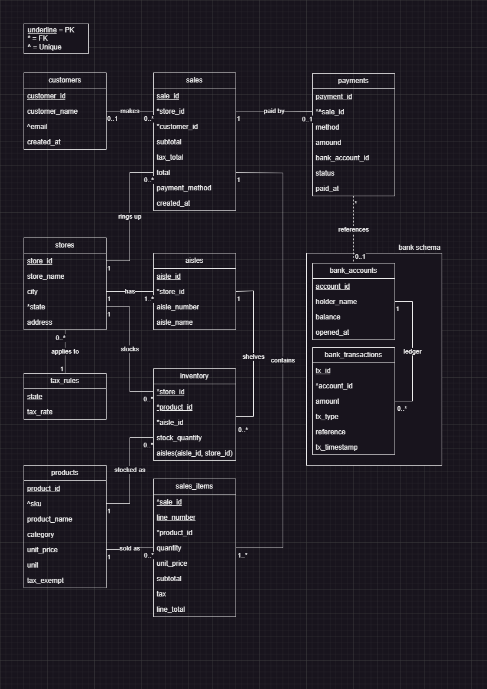

# SuperMart Chain - COSC 3380 HW2 Phase 1

## Team

| Member | Responsibility |
|---|---|
| Khusbhu Talaviya | Front End Design |
| Salman Zariwala | Back End Design |
| Benjamin Tri Minh Nguyen | DB and ER Design |


## Requirements

- Node.js 18+
- Local PostgreSQL 14+
- Browser

## Setup

1. Create an empty database:
   ```
   createdb supermart_hw2
   ```
2. Copy `_env_TEMPLATE` to a file named `.env` and fill in your PostgreSQL password:
   ```
   PGHOST=localhost
   PGPORT=5432
   PGDATABASE=supermart_hw2
   PGUSER=postgres
   PGPASSWORD=[PASSWORD]
   ```
3. Install and start:
   ```
   npm install
   npm start
   ```
4. Open <http://localhost:3000> (it redirects to `home.html`).
   Health check: <http://localhost:3000/api/health>.

## How to use the app

Go to the **Company Back Office** tab and follow the Phase 1 steps:

1. **Create Tables** - runs `schema.sql` (safe to click more than once).
2. **Initialize Lookup Tables** - runs `seed.sql`: 100 stores in 4 states, 20-40 aisles per store, 20 products, state tax rules, inventory for every store, 12 customers, 12 bank accounts. Re-running it resets the bank balances.
3. **Test Front Desk** - runs a card checkout of 10 random items at store 1 and shows the receipt and the new bank balance.
4. **Test Back Office Queries** - runs the six join reports in `query.sql`.
5. **Browse 10 Rows** - previews any table. **Delete All Rows** empties the selected table (`TRUNCATE ... CASCADE`) after a confirmation dialog.

The Front Desk tab lets you choose store, payment method (card or cash), bank account, and
number of items (10-20) and run a checkout. The panel at the bottom of the back office shows the SQL
that was sent to the database.

Demo account for the failure case: bank account 3 has only $5.00, so a card checkout with it
fails with an insufficient-funds error and everything is rolled back.

## ER Model

ER Model image was made with draw.io

